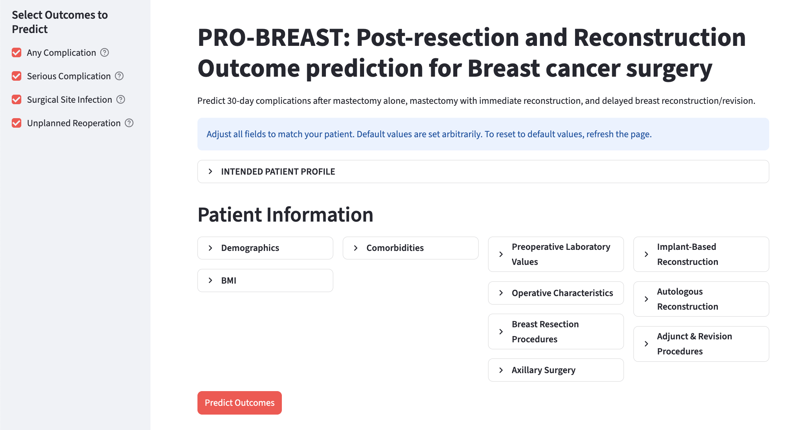

**Research prototype — preliminary models pending further validation.**

[Launch PRO-Breast <i class="fas fa-arrow-up-right-from-square" aria-hidden="true"></i>](https://pro-breast.streamlit.app){: .btn .btn--inverse target="_blank" rel="noopener"}

## Overview 

As part of [an ongoing research project](/publications/mastectomy), I developed an interactive risk calculator for four major 30-day postoperative complications following breast cancer surgery:

- Any complication
- Serious complications
- Surgical site infection
- Unplanned reoperation

The calculator uses calibrated gradient-boosted tree models (LightGBM and XGBoost) developed using approximately 335,000 patients (2014–2023) and temporally evaluated on approximately 32,000 patients (2024) from the ACS-NSQIP data registry. Models were selected based on preliminary predictive performance, with particular emphasis on clinically interpretable risk stratification.

## Key Features

- **Interpretable Risk Stratification:** Predicted probabilities are mapped to four risk groups (Very Low, Low, Moderate, and High) using logarithmically spaced probability thresholds derived from the development data.

- **Contextualized Risk Estimates:** Each risk group is presented alongside its observed event rate and probability thresholds, providing context relative to the study population. Individual predicted probabilities are also contextualized through percentile rankings.

- **Individualized Model Explanations:** Interactive visualizations of regularized SHAP (Shapley Additive exPlanations) values illustrate how individual input features contribute to the model's predicted risk relative to its baseline.

- **Transparent Handling of Missing Data:** Missing numerical inputs are automatically imputed, with imputed values explicitly flagged and displayed to help users interpret predictions in light of the available information.

## Ongoing Development and Limitations

Further model development incorporating 2024 data, temporal validation using 2025 ACS-NSQIP data, and benchmarking against the ACS-NSQIP Surgical Risk Calculator are planned.

The calculator is intended for research and demonstration purposes and has not yet been independently validated for clinical use.

## Links

- [Risk calculator](https://pro-breast.streamlit.app)
- [Associated research project](/publications/mastectomy)
- [Project code](https://github.com/AnthonyMatarr/ML-Breast-Pred)